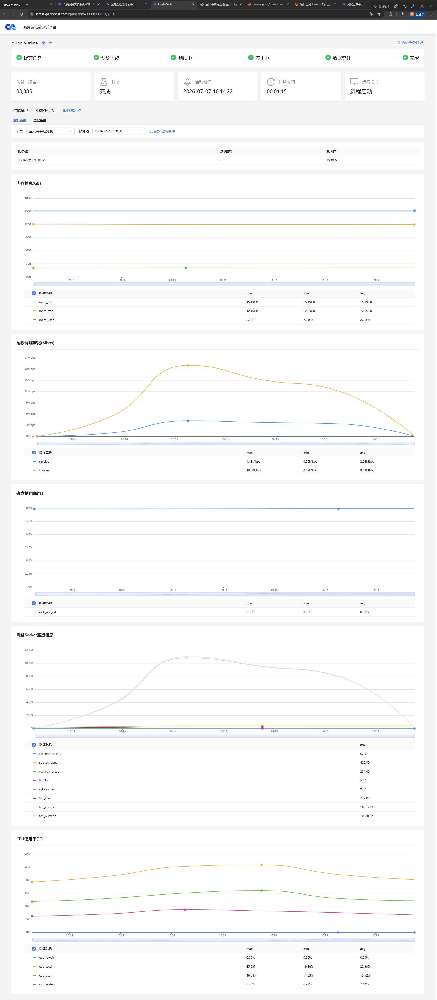
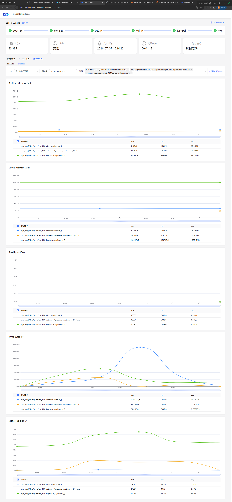
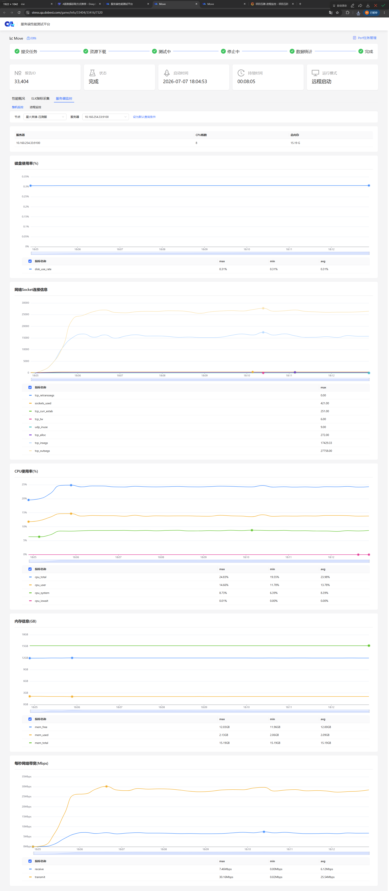
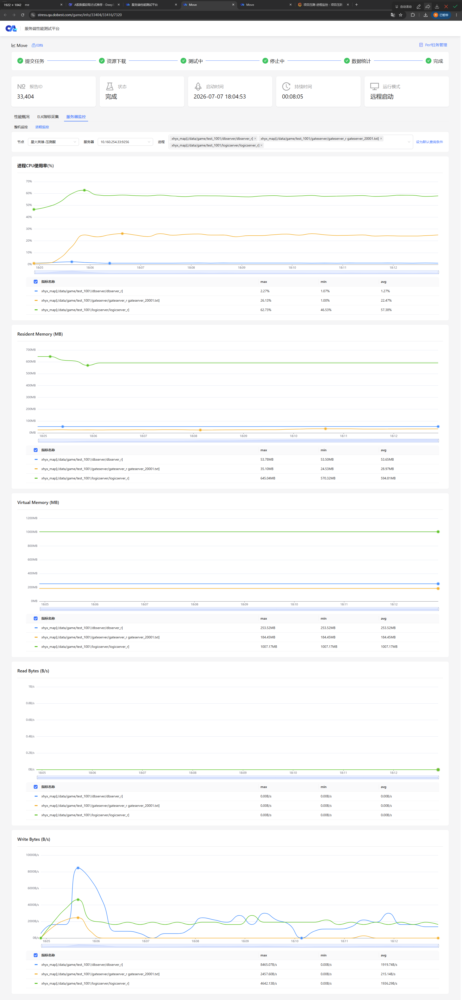
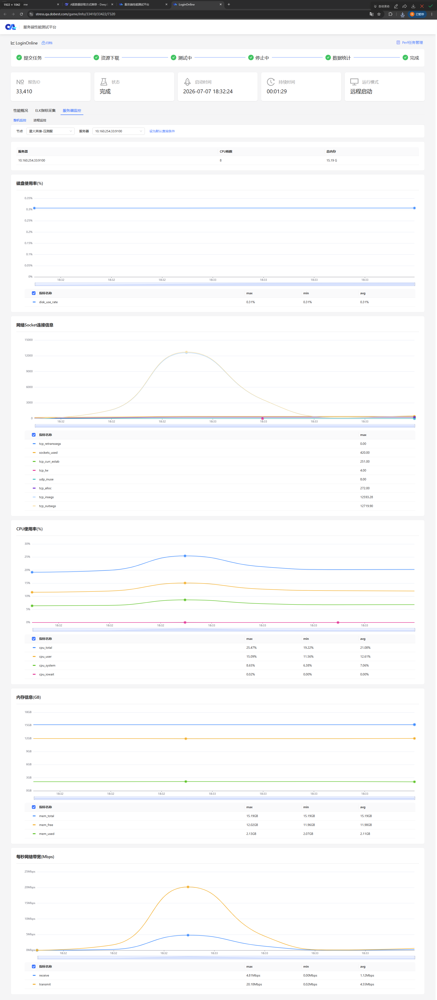
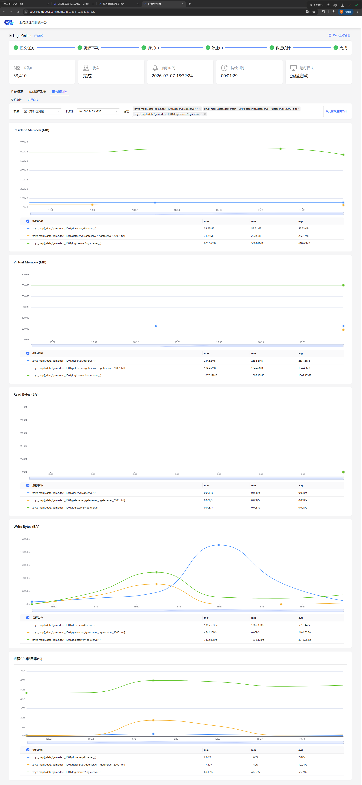
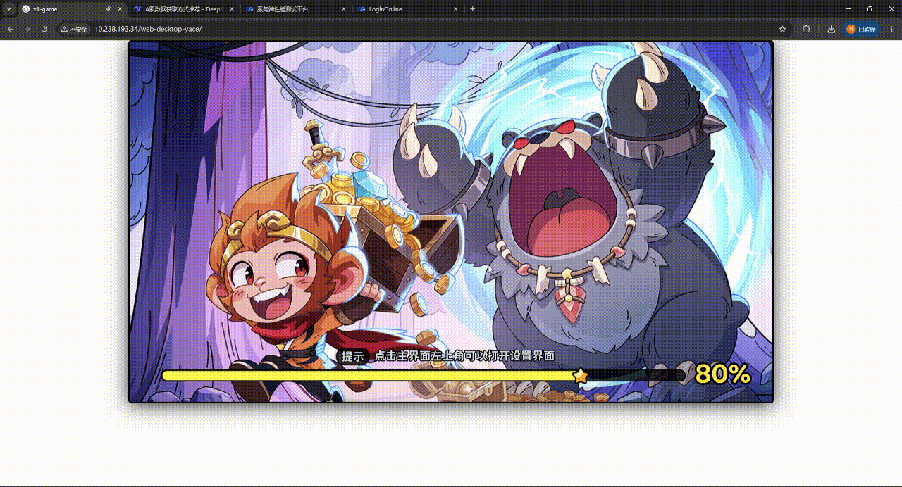

# 《星火英雄》国内App v6.3.0 版本 服务器性能测试报告

## 版本信息

|  版本  | 项目阶段 | 发行地区 | 测试人 |     测试时间      |
| :----: | :------: | :------: | :----: | :---------------: |
| v6.3.0 | 公开测试 |   国内   | 侯宇祺 | 2026/7/6~2026/7/9 |

## 需求概述

《星火英雄》计划于7月22日进行不删档付费测试，期望单服PCU为200。需进行如下测试：

1. 单场景测试：验证创角、登录、主城移动、野外战斗、首领魂卡、深渊副本玩法的性能是否达标。
2. 容量测试
3. 稳定性测试

## 测试结论

测试结论： 

概述：

## 遗留问题列表

| 问题描述                                                     | 等级 | 问题根因 |  计划  |
| :----------------------------------------------------------- | :--: | :------- | :----: |
| 200机器人以10/s的速率进行创角时，CReqCheckPassword 账号检查协议的TP90耗时7866ms, 大于5秒 |  高  | 待排查   | 待规划 |
| 200机器人以10/s的速率进行创角时，CReqCreateActor 创角协议的TP90耗时2134ms, 大于1.5秒； |  中  | 待排查   | 待规划 |
|                                                              |      |          |        |

## 测试项

本次测试含：

1. 单场景测试

### 单场景测试

#### 创角

<table>
    <tr>
        <td style="text-align: center;">测试项</td>
        <td style="text-align: center;">并发用户数</td>
        <td style="text-align: center;">协议名</td>
        <td style="text-align: center;">QPS</td>
        <td style="text-align: center;">成功率</td>
        <td style="text-align: center;">TP90</td>
        <td style="text-align: center;">dbserver进程CPU</td>
		<td style="text-align: center;">gateserver进程CPU</td>
		<td style="text-align: center;">logicserver进程CPU</td>
    </tr>
    <tr>
        <td style="text-align: center;" rowspan="5">创角</td>
        <td style="text-align: center;" rowspan="5">10</td>
        <td style="text-align: center;">CReqCheckPassword</td>
        <td style="text-align: center;">6.91</td>
        <td style="text-align: center;">100.00%</td>
        <td style="text-align: center;">7866ms</td>
        <td style="text-align: center;" rowspan="5">1.68%</td>
		<td style="text-align: center;" rowspan="5">9.9%</td>
		<td style="text-align: center;" rowspan="5">58.60%</td>
    </tr>
	<tr>
        <td style="text-align: center;">CReqCreateActor</td>
        <td style="text-align: center;">6.85</td>
        <td style="text-align: center;">100.00%</td>
        <td style="text-align: center;">2134ms</td>
    </tr>
	<tr>
        <td style="text-align: center;">CReqGetActorList</td>
        <td style="text-align: center;">6.86</td>
        <td style="text-align: center;">100.00%</td>
        <td style="text-align: center;">205ms</td>
    </tr>
    <tr>
        <td style="text-align: center;">CActorLogin</td>
        <td style="text-align: center;">6.83</td>
        <td style="text-align: center;">100.00%</td>
        <td style="text-align: center;">567ms</td>
    </tr>
    <tr>
        <td style="text-align: center;">CClientReadyLogin</td>
        <td style="text-align: center;">6.81</td>
        <td style="text-align: center;">100.00%</td>
        <td style="text-align: center;">567ms</td>
    </tr>
</table>

说明：测试期间，账号检查协议的TP90耗时为7866ms，大于5秒，创角协议的TP90耗时2134ms大于1.5秒。服务器资源性能无异常。

#### 主城移动

<table>
    <tr>
        <td style="text-align: center;">测试项</td>
        <td style="text-align: center;">并发用户数</td>
        <td style="text-align: center;">协议名</td>
        <td style="text-align: center;">QPS</td>
        <td style="text-align: center;">成功率</td>
        <td style="text-align: center;">TP90</td>
        <td style="text-align: center;">dbserver进程CPU</td>
		<td style="text-align: center;">gateserver进程CPU</td>
		<td style="text-align: center;">logicserver进程CPU</td>
    </tr>
    <tr>
        <td style="text-align: center;" rowspan="2">主城移动</td>
        <td style="text-align: center;" rowspan="2">200</td>
        <td style="text-align: center;">CActorMove</td>
        <td style="text-align: center;">200.01</td>
        <td style="text-align: center;">100.00%</td>
        <td style="text-align: center;">42ms</td>
        <td style="text-align: center;" rowspan="2">1.21%</td>
		<td style="text-align: center;" rowspan="2">24.80%</td>
		<td style="text-align: center;" rowspan="2">58.14%</td>
    </tr>
	<tr>
        <td style="text-align: center;">CActorSetDir</td>
        <td style="text-align: center;">185.99</td>
        <td style="text-align: center;">100.00%</td>
        <td style="text-align: center;">42ms</td>
    </tr>
</table>

说明：测试期间，主城移动玩法相关协议的TP90耗时均小于1秒、成功率为100%，服务器资源性能无异常。

#### 登录

<table>
    <tr>
        <td style="text-align: center;">测试项</td>
        <td style="text-align: center;">并发用户数</td>
        <td style="text-align: center;">协议名</td>
        <td style="text-align: center;">QPS</td>
        <td style="text-align: center;">成功率</td>
        <td style="text-align: center;">TP90</td>
        <td style="text-align: center;">dbserver进程CPU</td>
		<td style="text-align: center;">gateserver进程CPU</td>
		<td style="text-align: center;">logicserver进程CPU</td>
    </tr>
    <tr>
        <td style="text-align: center;" rowspan="3">登录</td>
        <td style="text-align: center;" rowspan="3">10</td>
        <td style="text-align: center;">CReqCheckPassword</td>
        <td style="text-align: center;">9.41</td>
        <td style="text-align: center;">100.00%</td>
        <td style="text-align: center;">731ms</td>
        <td style="text-align: center;" rowspan="3">1.21%</td>
		<td style="text-align: center;" rowspan="3">24.80%</td>
		<td style="text-align: center;" rowspan="3">58.14%</td>
    </tr>
	<tr>
        <td style="text-align: center;">CActorLogin</td>
        <td style="text-align: center;">8.27</td>
        <td style="text-align: center;">100.00%</td>
        <td style="text-align: center;">922ms</td>
    </tr>
    	<tr>
        <td style="text-align: center;">CClientReadyLogin</td>
        <td style="text-align: center;">8.26</td>
        <td style="text-align: center;">100.00%</td>
        <td style="text-align: center;">922ms</td>
    </tr>
</table>

说明：测试期间，登录玩法相关协议的TP90耗时均小于1秒、成功率为100%，服务器资源性能无异常。客户端卡顿感较为严重。

## 测试详情

### 单场景测试

#### 创角

测试策略：200机器人 以10/s的速率进行创角登录。

- [事务统计](https://stress.qa.dobest.com/game/info/33385/33397/7320)

  .png)

  说明：

  1. CReqCheckPassword 检查账号的TP90耗时7866ms, 大于5秒；
  2. CReqCreateActor 创角的TP90耗时2134ms, 大于1秒；

- 客户端监控

  .png)

- 服务端监控

  10.160.254.33 游戏服 整机监控

  

  说明：

  1. 整机的CPU均值占用为22.39%，峰值占用为25.83%；
  2. 每秒网络带宽receive均值为2.44Mbps，transmit均值为10.34Mbps；
  3. 内存从2.01GB上涨至2.09GB，上涨0.08GB。

  10.160.254.33 游戏服 进程监控

  

  说明：

  1. dbserver的CPU占用均值为1.68%；
  2. gateserver的CPU占用均值为9.90%；
  3. logicserver的CPU占用均值为58.60%。

#### 主城移动

测试策略：200机器人 以5/s的速率登录后，以200/s的速率在主城内进行移动。

- [事务统计](https://stress.qa.dobest.com/game/info/33404/33416/7320)

  .png)

  说明：CActorMove 移动协议的成功率为92.97%，失败的7.01%错误码为SActorMoveFail_5。

- 客户端监控

  .png)

- 服务端监控

  10.160.254.33 游戏服 整机监控

  

  说明：

  1. 整机的CPU均值占用为24.31%，峰值占用为24.72%；
  2. 每秒网络带宽receive均值为6.79Mbps，transmit均值为28.34Mbps；
  3. 内存从11.96GB上涨至12.03GB，上涨0.07GB。

  10.160.254.33 游戏服 进程监控

  

  说明：

  1. dbserver的CPU占用均值为1.21%；
  2. gateserver的CPU占用均值为24.80%；
  3. logicserver的CPU占用均值为58.14%。

#### 登录

测试策略：200机器人 以10/s的速率进行创角登录。

- [事务统计](https://stress.qa.dobest.com/game/info/33410/33422/7320)

  .png)

- 客户端监控

  .png)

- 服务端监控

  10.160.254.33 游戏服 整机监控

  

  说明：

  1. 整机的CPU均值占用为21.08%，峰值占用为25.47%；
  2. 每秒网络带宽receive均值为2.14Mbps，transmit均值为8.85Mbps；
  3. 内存从11.98GB上涨至12.02GB，上涨0.04GB。

  10.160.254.33 游戏服 进程监控

  

  说明：

  1. dbserver的CPU占用均值为1.88%；
  2. gateserver的CPU占用均值为7.83%；
  3. logicserver的CPU占用均值为54.92%。

- 客户端表现

  

  说明：客户端登录耗时15秒，卡顿感明显。

